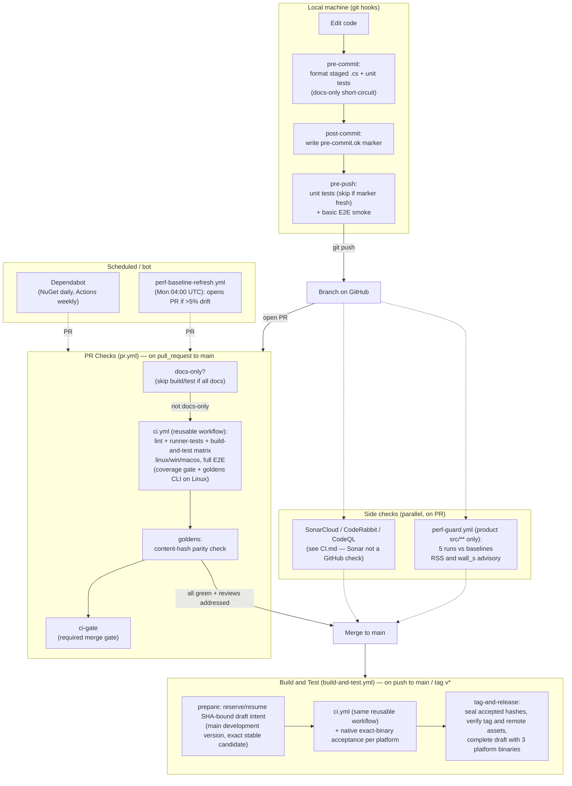

# CI/CD

How code travels from a local edit to a tagged release in Zipper, and the gates it must clear on the way. This is the **source-of-truth** map of the pipeline; [CI.md](../CI.md) holds the operational detail for external checks (SonarCloud, CodeRabbit, CodeQL, goldens, dependency policy), and [AGENTS.md](../AGENTS.md) holds the per-issue workflow.

> **For agents:** follow the [Quick Reference for Agents](#quick-reference-for-agents) — it maps each pipeline stage onto the local command that reproduces it, so you fail fast locally instead of waiting on CI.

## Pipeline overview

## Stages

### 1. Local git hooks

Version-controlled in [`.github/hooks/`](../.github/hooks/), installed with `./setup-hook.sh` (Linux/Mac) or `setup-hook.bat` (Windows). They copy into `$(git rev-parse --git-common-dir)/hooks/` and are worktree-aware.

| Hook | Trigger | Does |
|------|---------|------|
| `pre-commit` | `git commit` | Short-circuits if every staged file is docs (`*.md`, `docs/`). Else stashes unstaged changes, runs `dotnet format` on staged `*.cs`, runs all unit tests. |
| `post-commit` | after commit object exists | Writes `pre-commit.ok` marker (timestamp + new HEAD) so pre-push can skip redundant unit tests. |
| `pre-push` | `git push` | Unit tests (skipped if marker is <10 min old on current HEAD) + basic E2E smoke (`tests/run-e2e-basic.sh` / `.bat`). |

Bypass (not recommended): `git commit --no-verify`, `git push --no-verify`. Full E2E + coverage run in CI only.

### 2. PR Checks — [`pr.yml`](../.github/workflows/pr.yml)

Trigger: `pull_request` → `main`. Concurrency-cancels superseded runs. Jobs are gated on `docs-only` so a pure-docs PR skips build/test entirely.

1. **docs-only** — diffs base..head; if **every** changed file matches a docs pattern, sets `only_docs=true` and the rest of the pipeline is skipped. A failed diff or zero changed files is treated as non-docs (fail-safe).
2. **ci** (reusable workflow, [ci.yml](../.github/workflows/ci.yml)) — the shared job graph, identical for PRs and main. Keeping it in one file is what stops the two callers drifting apart: the `git config user.name` guard that reddened main CI for 15 hours (#1173) existed on the PR side only, and both callers now get every gate from the same definition. Inputs: `publish_mode: goldens` on PRs (publishes the framework-dependent Linux CLI as `zipper-cli-linux`), `self-contained` on main (publishes per-RID release binaries), `version` on main. A PR that edits `ci.yml` is checked out with a read-only token, so a change is validated by the version it ships with.
   - **lint** — `actionlint`, `dotnet restore --locked-mode`, `dotnet format --verify-no-changes`, requirement-traceability validation, `.sh`/`.bat` E2E parity, an oversized-file guard (>500 KB under `src/`, excluding `*.json`/`*.dat`/`*.opt`), and a swallowed-test-output guard.
   - **runner-tests** — `.zipper-runner/tests` (runner CLI, subprocess, and Git-boundary regressions) on an isolated checkout, on `ubuntu-latest` and `macos-latest`. The suites carry their own fixture Git identity (`.zipper-runner/tests/gitenv.py`), which is what actually makes them pass on a machine with no global `user.name`/`user.email`; the job also fills a missing global identity as defence in depth for Git work outside those suites. Output is teed to a log so a non-zero exit never loses its traceback. These suites deliberately do **not** run inside the .NET E2E suite: a Git-environment failure then reported as a product regression, which is how #1173 was misdiagnosed as a code bug for a day. Windows is excluded because the suites install fake executables with a shebang and `chmod +x`, which Windows cannot execute — see the comment on the matrix.
   - **build-and-test** — matrix over `ubuntu` / `windows` / `macOS`. Builds Release (includes tests), runs unit tests, full E2E suite. **Linux leg only** also: code coverage + **80% total line-coverage gate** and **50% per-file coverage floor** ([coverage-gate action](../.github/actions/coverage-gate/action.yml)), vulnerable-package scan (hard gate), test-timing report, and the Linux CLI publish consumed by `goldens`.
3. **goldens** — downloads the Linux CLI artifact and runs golden scenarios (content-hash parity). See [CI.md](../CI.md#goldens) to regenerate.
4. **ci-gate** — aggregate merge gate; branch protection requires exactly this check context and nothing else. It always runs (even on docs-only PRs where everything above is skipped), and fails if any needed job failed or was cancelled.

### 3. Side checks (parallel on PR)

- **perf-guard** — [`perf-guard.yml`](../.github/workflows/perf-guard.yml), triggered on product code under `src/**` (excluding test and analyzer projects). Runs `measure.sh` 5×, takes the median, and compares to `tests/perf/baselines.json` via [`.github/scripts/perf-compare.py`](../.github/scripts/perf-compare.py). **RSS > 1.20× baseline is advisory**, as is `wall_s` (shared-runner variance); measurement and comparison errors still fail. Posts/updates one PR comment with the result table.
- **SonarCloud / CodeRabbit / CodeQL** — see [CI.md](../CI.md). SonarCloud is **not** surfaced as a GitHub check; fetch it manually after CI completes. CodeQL failures block merge. CodeRabbit blocking issues required, nitpicks optional.
- **typesafe-audit** — [`typesafe-audit.yml`](../.github/workflows/typesafe-audit.yml), **advisory only** (never blocks). Path-filtered on PR (`Requirements.md`, `docs/`, `src/`, `tests/`, `tools/typesafe-audit/`), a weekly full audit (Monday 06:00 UTC), and manual `workflow_dispatch` (`changed`/`full`). Runs the Python audit runner in `tools/typesafe-audit/` with the `TYPESAFE_API_KEY` repository secret; fork PRs (no secret access) skip with a neutral summary. Uploads JSON/Markdown reports (7-day retention) and writes a job summary. Remote failures are always non-blocking. See [CI.md](../CI.md#typesafe-audit).
  - **Bounded concurrent audits** — the five audit checks run as matrix jobs with `max-parallel: 2` and `fail-fast: false`. Each job has an isolated checkout, summary, and `typesafe-audit-report-<check>` artifact; the independent PR specification review retains its own artifact. No native `background`/`wait` syntax is used: local actionlint 1.7.12 rejects those keywords. Build, E2E, coverage, goldens, and release gates remain unchanged.
  - **Foundation audit (#955)** — fixed sample scope via `tools/typesafe-audit/runner.py`.
  - **Requirements semantic audit (#956)** — `tools/typesafe-audit/checks/requirements/run_check.py`: deterministic changed-section extraction, prechecks (immutable REQ IDs, orphan references, missing traceability rows), then five advisory TypeSafe judgments (testability, contradiction, non-canonical terms, completeness, doc sync). PR mode audits changed sections (docs-only PRs included); `workflow_dispatch` with `mode: full` audits every active requirement in a bounded request budget. Findings cite supplied evidence spans only; low-confidence signals are `needs-human-review`, never defects. Local reproduction: `python3 tools/typesafe-audit/record_corpus_fixtures.py /tmp/tsa-fx && python3 tools/typesafe-audit/checks/requirements/run_check.py --corpus tests/typesafe-audit-fixtures --mode fixture --fixture-dir /tmp/tsa-fx --json-out req.json --md-out req.md`.
  - **Semantic traceability audit (#957)** — `tools/typesafe-audit/checks/traceability/run_check.py`, run after the blocking `validate-req-traceability.sh --strict` gate: resolves each mapped test to its exact source (unit `Class.Method`, e2e `script.sh Scenario`) deterministically, then judges coverage as `full`/`partial`/`none`/`ambiguous` with separate mocked-only and execution-only signals. Advisory; unresolved refs, malformed rows, and oversized evidence exit 2 before any model call.
  - **Architecture seam lint** — `tools/typesafe-audit/checks/architecture/run_check.py`, a step in the `typesafe-audit` workflow's `audit` job: on diffs touching `src/LoadFiles/**`, `src/ProductionSets/**`, `src/Validation/**`, `src/Cli/Modules/**`, or `docs/architecture.md`, two advisory TypeSafe judgments (`seam_bypass`, `diagram_stale`) guard architectural invariants; no seam file touched -> neutral skip without a model call; carve-out (`XmlLoadFileWriter.cs`) change without a same-diff `docs/architecture.md` update -> deterministic `needs-human-review`. Advisory, never gates.
  - **Domain language lint** — `tools/typesafe-audit/checks/domain_language/run_check.py`, a step in the `typesafe-audit` workflow's `audit` job: on diffs touching text/code, evaluates domain terminology against `UBIQUITOUS_LANGUAGE.md` (Critical Rule 1), flagging non-canonical aliases (`non_canonical_alias`) as findings while passing canonical terms (`canonical`) and non-domain text (`clean_no_domain_terms`). Advisory, never gates.
  - **PR specification compliance side check (#958)** — independent `pr-spec-review` job on same-repo PRs (forks skip). `checks/pr-spec/collect_pr.py` gathers changed files (budgeted, no binaries/secrets), explicit `Fixes/Closes/Resolves #N` issue refs with chronological bodies+comments (newest flagged `supersedes_older` wins), affected REQ IDs, and supplied policy excerpts (`AGENTS.md`, glossary, review guidelines). Four advisory judgments per obligation: implementation Choice, real-outcome-test Noul, unrelated-behavior Noul, docs-sync Choice. No explicit spec → neutral `no-explicit-spec`; low confidence → `needs-human-review`. Never gates.
  - **Quality prioritization audit (#959)** — separate [`typesafe-quality-audit.yml`](../.github/workflows/typesafe-quality-audit.yml), weekly + manual dispatch (supports PR delta mode via `--changed-files`), never on PRs: coverlet Cobertura → deterministic gap extraction (`quality/coverage_gaps.py`), pinned `dotnet-stryker` shard → deterministic mutant categories (`quality/mutation.py`), TypeSafe Score questions (correctness, data loss, security, regression) composed via checked-in weights with raw components always retained. Advisory; deterministic tools own coverage/survivor truth.
  - **Issue triage (dry run, #960)** — [`typesafe-issue-triage.yml`](../.github/workflows/typesafe-issue-triage.yml) on issue events + dispatch, `contents: read` / `issues: read` only: deterministic keyword retrieval of duplicate candidates plus closed-set TypeSafe Choices (type, subsystem, priority, duplicate judgment) and Nouls (missing info, REQ relevance) in a JSON/Markdown/summary report. Dry run only — never writes to GitHub; write-mode promotion is a separate reviewed PR.

### 4. Build and Test (main) — [`build-and-test.yml`](../.github/workflows/build-and-test.yml)

Trigger: `push` → `main`, stable tags `v*`, and manual recovery via `workflow_dispatch`. One repository-wide release concurrency group serializes allocation/publication; in-progress runs are never superseded/cancelled. GitHub can replace a pending run before it starts (and before it reserves an intent). The pinned actionlint does not support `queue: max`; the workflow does not claim an unbounded pending queue.

1. **prepare** — `.github/scripts/release.py` reserves or resumes a draft release intent for the exact checked-out SHA. The controller runs from a second checkout of the triggering ref (`.controller`), so recovery dispatches execute the current fixed controller rather than the one in the historical source SHA. Recovery matches drafts by the terminal intent's tag, not the mutable draft name. Main development builds retain the next patch from the latest Git tag plus `-dev` (REQ-033); the stable candidate gets the intent's separately reserved version. Tag pushes use the exact stable tag and verify its source. Draft reservations count toward stable allocation so failed builds cannot reuse another intent's version. A stale main SHA without an intent is skipped rather than allocated a newer version. Completed intents skip CI/publication.
2. **ci** (reusable workflow, [ci.yml](../.github/workflows/ci.yml)) — shared gates plus self-contained native candidates on Linux, Windows, and macOS. Build and publish receive explicit version/source metadata. The candidate's native executable, not a framework-dependent build fallback, must pass independent bundle-metadata inspection, `--version`, invalid invocation, Standard Archive/Load File checks, Loadfile-Only Load File/Audit File checks, and Production Set checks. Acceptance records bind each executable to its SHA-256, version, and source SHA. Linux runs golden parity against the same candidate. PRs also exercise native candidate acceptance; main uploads accepted candidates with 30-day retention.

   The trade-off is that main now runs **strictly more gates than it did before** the shared workflow existed — its old `lint` job was restore + format only, while `ci` also runs `actionlint`, the requirement-traceability and `.sh`/`.bat` parity checks, the oversized-file and swallowed-output guards, the vulnerable-package scan, and `runner-tests`. Most of these can turn a main push red **without any repository change**: `dotnet list package --vulnerable` consults the live NuGet vulnerability database, so a CVE disclosed for a transitive package after merge reddens main with no PR to point at, and `runner-tests` spawns real subprocesses. Expect this: a red `Build and Test` check after a quiet period is not automatically a regression from the last merge. If it happens, re-run first to distinguish a new CVE from a real break.
3. **tag-and-release** — runs only after all shared gates pass. Seals the accepted artifact hashes, immutable artifact IDs, and original artifact run into the draft intent before pushing its exact source-SHA tag. Existing tags must match; uploaded assets are never overwritten. An empty draft `starter` placeholder from a failed upload may be deleted and retried. Each uploaded asset is downloaded and hashed before the draft becomes public, with exactly the three expected executables. The intent transitions `reserved → sealed → completed`; a partial retry resumes the same tag/assets, downloading the sealed artifact IDs rather than reusable artifact names. Completed retries are no-ops, and old main recovery cannot promote a release as newest. Every draft update re-sends the intent's `tag_name` and `target_commitish` — omitting them lets GitHub rename the draft to an auto-generated `untagged-…` name and breaks tag-based upload. A sealed draft already detached that way is re-bound to its intent tag after its source tag and local accepted bytes verify, before any upload; named-tag, public, unsealed, or source-mismatched drift fails closed. Manual tags use this same tested publication path. Recovery dispatch requires an existing `source_sha`; add `release_tag` when the source has multiple intents. Accepted artifacts have 30-day retention; expiry fails closed rather than silently replacing sealed bytes. Release notes still prefer the PR's `## Release Notes`, then the GitHub Models summary, then the static fallback. The notes and validated terminal intent remain in the same release body; notes cannot supply intent state.

### 5. Scheduled / bot

- **perf-baseline-refresh** — [`perf-baseline-refresh.yml`](../.github/workflows/perf-baseline-refresh.yml), Monday 04:00 UTC (or manual `workflow_dispatch`). Re-measures (5 runs, take max), and if any metric drifts ≥5% opens a `chore: refresh perf baselines` PR with a review checklist. **Requires the `PERF_BASELINE_TOKEN` repository secret** (a fine-grained PAT with `contents:pull-requests:write`): the action opens the PR from a branch it pushes, and a branch pushed with the default `GITHUB_TOKEN` makes the PR author `github-actions[bot]`, which GitHub holds at `action_required` — so `PR Checks` never runs, `ci-gate` never posts, and the PR can never be merged (observed on PR #1187). Without the secret the workflow now **fails explicitly** instead of silently opening an unmergeable PR.
- **Dependabot** — [`dependabot.yml`](../.github/dependabot.yml). NuGet daily (grouped minor/patch vs major), GitHub Actions weekly. Subject to the **3-day waiting period** before merge — see [CI.md](../CI.md#dependency-update-policy).
- **Weekly functional QA** — [`qa.yml`](../.github/workflows/qa.yml), Sunday 02:00 UTC (or manual `workflow_dispatch`). Full cross-platform functional and E2E regression suite across Windows, macOS, and Linux runners.
- **Nightly Zip64 scale test** — [`zip64-nightly.yml`](../.github/workflows/zip64-nightly.yml), nightly at 01:00 UTC. Exercises 100GB+ generation and Zip64 entry bounds on large runner storage.
- **TypeSafe quality prioritization audit** — [`typesafe-quality-audit.yml`](../.github/workflows/typesafe-quality-audit.yml), Monday 06:00 UTC (or manual `workflow_dispatch`). Runs coverage gap extraction, Stryker mutation testing shard, and TypeSafe scoring.
- **TypeSafe full audit** — [`typesafe-audit.yml`](../.github/workflows/typesafe-audit.yml), Monday 06:00 UTC. Full audit of requirements, traceability, and architecture seams.

## Gates summary

| Gate | Where | Blocking? |
|------|-------|-----------|
| Format (`dotnet format`) | pre-commit, lint | Yes |
| Unit tests | pre-commit/pre-push, build-and-test | Yes |
| Runner CLI/subprocess/Git regressions | runner-tests | Yes |
| Release recovery / explicit executable regressions | runner-tests | Yes |
| Native shipped-binary acceptance + Linux candidate goldens | build-and-test | Yes |
| Line coverage ≥ 80% | build-and-test (Linux) | Yes |
| Full E2E (all 3 OS) | build-and-test | Yes |
| Golden parity | goldens | Yes |
| Oversized file (>500 KB) | lint | Yes |
| Vulnerable NuGet packages | build-and-test (Linux) | Yes |
| E2E `.sh`/`.bat` parity | lint | Yes |
| Perf RSS ≤ 1.20× | perf-guard | No (advisory; measurement errors block) |
| Perf wall_s | perf-guard | No (informational) |
| SonarCloud BLOCKER/MAJOR | external | Yes (manual fetch) |
| CodeQL | external | Yes |
| CodeRabbit blocking | external | Yes (nitpicks optional) |
| TypeSafe audit findings | typesafe-audit | No (advisory; never blocks) |

## Quick Reference for Agents

Reproduce each CI gate locally **before** pushing — CI minutes are slow feedback. Use `rtk` prefixes per [CLAUDE.md](../CLAUDE.md).

| CI gate | Local equivalent |
|---------|------------------|
| lint (format) | `dotnet format --verify-no-changes src/` |
| build | `dotnet build zipper.sln -c Release` |
| unit tests + coverage gate | `dotnet test src/Zipper.Tests/Zipper.Tests.csproj --collect:"XPlat Code Coverage" --results-directory ./TestResults && dotnet test src/Zipper.Analyzers.Tests/Zipper.Analyzers.Tests.csproj` (then run `dotnet reportgenerator -reports:TestResults/*/coverage.cobertura.xml -targetdir:TestResults/coverage-report -reporttypes:TextSummary` and check line coverage ≥ 80%) |
| runner-tests | `HOME=/nonexistent python3 -m unittest discover -s .zipper-runner/tests` (the empty `HOME` proves the suite carries its own fixture Git identity). Windows is not covered: the suites install shebang'd fake executables. |
| full E2E | `dotnet build -c Release && ./tests/run-tests.sh` (Unix) / `dotnet build -c Release && tests\run-tests.bat` (Windows) |
| basic E2E smoke (pre-push) | `./tests/run-e2e-basic.sh` (Unix) / `tests\run-e2e-basic.bat` (Windows) |
| goldens | `dotnet publish src/Zipper.csproj -c Release -o ./publish-bin && ZIPPER_CLI=$(pwd)/publish-bin/Zipper bash tests/goldens/run-goldens.sh` |
| perf-guard | `dotnet publish src/Zipper.csproj -c Release -o ./publish-bin && ./tests/perf/measure.sh ./publish-bin/Zipper` |
| self-contained release publish | `dotnet publish src/Zipper.csproj -c Release -r linux-x64 --self-contained true -o publish/linux-x64` (also `win-x64`, `osx-arm64`) |
| release recovery | `python3 -m unittest discover -s tests/ci -v` (offline Git/CLI/file-transfer boundaries) |
| compiled version metadata | `bash tests/test-build-version.sh` |
| exact published-binary acceptance | `ZIPPER_EXECUTABLE=/absolute/path/to/binary EXPECTED_VERSION=X.Y.Z EXPECTED_SHA=<source-sha> bash tests/test-published-artifact.sh` (native Windows: `.bat`) |

**Rules of the road:**
- Install the hooks once (`./setup-hook.sh`) so format + tests run before every commit/push.
- A docs-only PR skips the build matrix — don't wait on jobs that won't run.
- Don't merge until PR Checks **and** side checks are green and all reviewer comments are addressed ([AGENTS.md workflow steps 9–12](../AGENTS.md#workflow-for-github-issues)).
- Changing a shared gate? Edit [ci.yml](../.github/workflows/ci.yml) — it applies to PRs **and** main, so one diff covers both. Main therefore inherits every PR gate, including the time-varying ones (see §4). Editing a caller (`pr.yml`, `build-and-test.yml`) is only for wiring: triggers, `docs-only` gating, `goldens`, version computation, and release publication.
- Changing a workflow? `actionlint` runs in `lint`; pin any new action to a full commit SHA (SonarCloud flags unpinned actions as security hotspots — see [CI.md](../CI.md#quality-gate-vs-code-issues)). Local check before pushing: `actionlint`.
- A behavior change that alters output **bytes** will trip goldens; performance changes produce advisory warnings from perf-guard.

### Audit concurrency measurement and limits

Run `python3 tools/typesafe-audit/benchmark_concurrency.py` from the repository
root. It records existing offline corpus fixtures, alternates seven serial and
seven two-worker replays, checks successful exits, and compares all five JSON
and five Markdown reports byte-for-byte. It never calls the live API.

Local Linux measurement on 2026-10-07 (12 available CPUs, Python 3.14):
serial median **0.534 s**, two-worker median **0.314 s**, **1.70×** speedup.
Repeating with `taskset -c 0,1` to restrict all benchmark subprocesses to two
CPUs gave **0.486 s → 0.385 s**, **1.26×**, with the same report parity.
This affinity check tests CPU contention, not separate hosted matrix runners.
This measures audit subprocess work, **not hosted CI wall time**. Matrix jobs
add four checkouts and artifact uploads relative to the original single job;
queueing and setup can outweigh the measured 0.220 s local saving. A hosted
before/after measurement is required before claiming a CI speedup or cost saving.

The matrix cap applies only to these five audit jobs. PR specification review
can add another API caller, other workflow runs can overlap, and repository or
organization runner capacity can reduce actual concurrency. No account-specific
TypeSafe quota was verified. Existing runners allow 60 seconds per HTTP request
and retry HTTP 429/529 once after two seconds. Requirements and traceability
checks each retain a 40-request budget (10 requirements/mappings per batch);
the 10-minute job timeout is not a guarantee that the full budget completes
under sustained slow responses. Request counts and paid API usage are not reduced
by concurrent jobs. Keep performance measurements isolated, and do not overlap
publish/E2E builds against shared `bin`/`obj` outputs.
